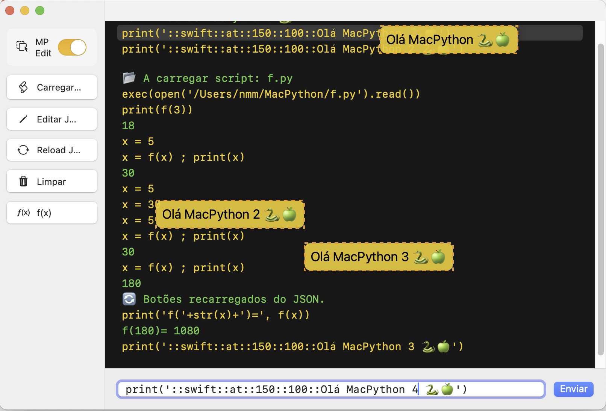

# MacPython 🐍

**Versão:** 0.1  
**Autor:** Nuno C. Marques  
**Ano:** 2026

O **MacPython** é uma aplicação para macOS construída em **SwiftUI**, que combina um terminal interactivo com um *Canvas* 2D. Executa um processo Python 3 em background e estabelece uma ponte bidireccional entre o interpretador e a interface gráfica.

A ideia é simples: manter a flexibilidade de uma sessão Python interactiva e acrescentar-lhe uma interface nativa, com uma paleta de ferramentas configurável e objectos gráficos que podem ser manipulados directamente.



## Funcionalidades

- **Sessão Python persistente:** os comandos são executados no mesmo interpretador, mantendo o estado e as variáveis entre execuções.
- **Terminal interactivo:** comandos anteriores podem ser recuperados com um clique ou arrastados para a linha de input. As setas ↑ e ↓ permitem percorrer o histórico.
- **Selecção de texto:** o output do terminal pode ser seleccionado e copiado.
- **Paleta dinâmica:** os botões da barra lateral são definidos em `botoes.json`. É possível editar e recarregar o ficheiro, ou acrescentar botões a partir de Python.
- **Canvas 2D:** permite criar e actualizar objectos de texto e imagens. A actualização de um objecto com o mesmo nome altera o objecto existente, em vez de criar outro.
- **MP Edit — interacção bidireccional:** permite arrastar objectos no Canvas e disponibiliza as novas coordenadas no interpretador Python, através do dicionário `macpython_pos`.
- **Interface ajustável:** a janela e a divisão entre a barra lateral e a área de trabalho podem ser redimensionadas.

## Requisitos

- macOS
- Swift (com `swiftc`)
- Python 3 acessível através de `python3` no `PATH`

## Compilar e executar

Na pasta que contém os ficheiros Swift (`Models.swift`, `MotorPython.swift`, `Components.swift` e `MacPythonApp.swift`), executar:

```bash
swiftc -parse-as-library *.swift -o macpython
./macpython
```

A aplicação cria e utiliza o ficheiro `botoes.json` para guardar a configuração da paleta.

## A ponte Python ⇄ Swift

A comunicação com a interface é feita através de instruções especiais escritas com `print()`, usando o prefixo `::swift::`.

### Limpar o Canvas

```python
print("::swift::clear")
```

### Criar e actualizar texto

O nome é opcional, mas permite actualizar posteriormente o mesmo objecto.

```python
print("::swift::name::etiqueta_1")
print("::swift::at::200::150::Olá MacPython!")
```

### Inserir uma imagem

O caminho deve apontar para um ficheiro de imagem acessível no Mac.

```python
print("::swift::name::meu_grafico")
print("::swift::image::300::200::/caminho/para/grafico.png")
```

### Acrescentar um botão à paleta

A instrução recebe o título, o comando Python e um nome de ícone SF Symbols, separados por `::`.

```python
print("::swift::button::Limpar Tudo::print('::swift::clear')::trash")
```

O botão é acrescentado à paleta e a configuração é guardada em `botoes.json`.

## MP Edit: do Canvas para Python

O modo **MP Edit** é activado pelo botão correspondente na barra lateral (comando `::swift::sys::toggle_edit`). Com o modo activo, os objectos do Canvas podem ser arrastados com o rato.

Quando um objecto é largado, a nova posição é comunicada ao interpretador e registada em `macpython_pos`, usando o nome do objecto como chave.

Por exemplo:

```python
print("::swift::name::meu_texto")
print("::swift::at::100::100::Arraste-me!")
```

Depois de activar o MP Edit e arrastar o objecto:

```python
print(macpython_pos["meu_texto"])
```

O resultado é a tupla com as coordenadas `(x, y)` do objecto.

## Documentação

A descrição dos módulos Swift, da estrutura do projecto e dos comandos de sistema está em [Documentação API`](MacPython.v0.1/API.md).

## Licença

Este projecto é disponibilizado sob a **Licença MIT**.  
Criado por Nuno C. Marques (2026).
